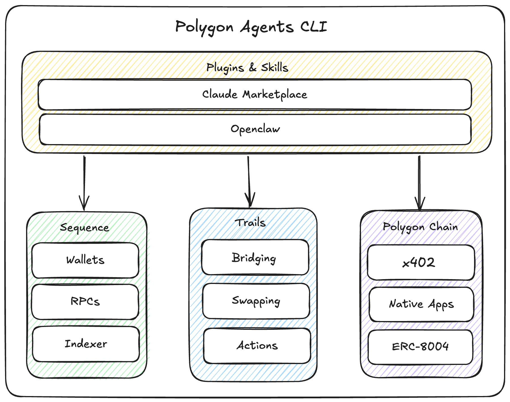

# Polygon Agent CLI

<p align="center">
  
</p>

Monorepo for the Polygon Agent CLI — everything AI agents need to operate onchain.

## Polygon Agent CLI

You're probably looking for the CLI. Head to the package for full documentation:

**[`packages/polygon-agent-cli/`](packages/polygon-agent-cli/)** — `@polygonlabs/agent-cli` on npm

Personal assistants (Muse, OpenClaw, Hermes, Grok Bot, Claude Code, Codex, Cursor): give the assistant https://agents.polygon.technology/skill.md and ask it to set up your wallet. That page is the Open Money Agent skill ([`skills/open-money-agent/`](skills/open-money-agent/)), your own agent for payments on the Open Money Stack (OMS): a short index that installs the CLI, checks the wallet's status, and opens a reference for each use case only when it's needed.

Install as a skill:

```bash
npx skills add https://github.com/0xPolygon/polygon-agent-cli
```

Or install the plugin, which bundles the same skill:

- Claude Code: `/plugin marketplace add 0xPolygon/polygon-agent-cli`, then `/plugin install open-money-agent@polygon-agent-cli`
- Codex and Cursor: add this repository (`0xPolygon/polygon-agent-cli`) as a plugin marketplace, then install `open-money-agent`

The manifests live at the repo root (`.claude-plugin/`, `.codex-plugin/`, `.cursor-plugin/`, `.agents/plugins/`) and point at [`plugins/open-money-agent/`](plugins/open-money-agent/), whose `skills/` and `assets/` link back to the root folders.

Or install the CLI directly:

```bash
npx @polygonlabs/agent-cli --help
```

## Other Packages

This repository also contains supporting packages:

- **[`packages/agentconnect-ui/`](packages/agentconnect-ui/)** — React app (served at `agentconnect.polygon.technology`) that the CLI opens for browser-based wallet login with Google or email
- **[`packages/oidc-relay/`](packages/oidc-relay/)** — Cloudflare Worker that pairs the login page with the CLI during browser login

## Development

```bash
pnpm install
pnpm polygon-agent --help
```

Requirements: Node.js 20+, pnpm

## License

MIT
